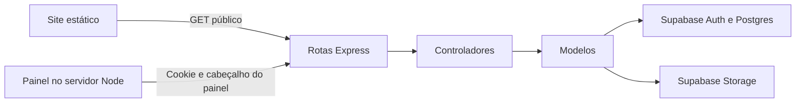

# Rame Seishin Jutsu

Site institucional sobre história, fundamentos e mestres, integrado a uma API de eventos, galeria de fotos e painel administrativo. Frontend HTML/CSS/JavaScript e backend Node.js com Supabase.

**Site:** [rame-seishin-jutsu.vercel.app](https://rame-seishin-jutsu.vercel.app). Respondeu HTTP 200 em 25/11/2026. Isso não comprova login, uploads ou operações administrativas.

## Funcionalidades e estado

- Páginas institucionais e exibição pública de eventos/fotos.
- Login administrativo por nome/senha e sessão em cookie HTTP-only.
- Criação, edição e exclusão de eventos, com controle de versão para concorrência.
- Upload/conversão de imagens com Sharp; quatro arquivos por envio, 6 MB por arquivo e até 24 fotos por evento.
- Substituição/restauração das quatro fotos institucionais.
- Cadastro de administradores por administradores autenticados; somente a conta principal lista, exclui ou redefine senhas das demais contas.

Capacidades presentes no código. Esta revisão não fez escritas no Supabase, login real ou migrations.

## Tecnologias

Frontend sem framework, build em Node `>=18`. O backend exige **Node 24.x**, usa CommonJS, Express `^5.3.0`, Supabase JS `^2.119.0`, Multer `^2.5.0`, Sharp `^0.35.5`, cookie-parser e express-rate-limit. Intervalos conforme manifests; resoluções em `backend/package-lock.json`.

## Arquitetura e estrutura



- `src/paginas/`, `src/css/`, `src/js/`, `src/imagens/`: site público.
- `backend/servidor.js`: middleware HTTP, API e arquivos estáticos.
- `backend/rotas/api.js`: rotas, acesso e upload.
- `backend/controladores/`: autenticação, eventos e fotos.
- `backend/modelos/`: acesso a Auth, tabelas e Storage.
- `backend/views/`: painel administrativo.
- `supabase/migrations/`: esquema SQL versionado.
- `scripts/build.mjs`: gera `dist/`, substituindo a saída anterior.

## Ambiente local

Use Supabase de desenvolvimento separado da produção. Revise as migrations em ordem antes de aplicá-las manualmente apenas nesse ambiente. A conta principal deve existir no Auth e estar confirmada; indique o UID em `ID_ADMIN_PRINCIPAL` ou confira a alternativa de conta interna em `backend/modelos/administradores.js`.

```bash
npm ci --prefix backend
```

Copie `backend/.env.example` para `backend/.env`, preenchendo apenas no seu ambiente:

| Variável | Uso |
| --- | --- |
| `SUPABASE_URL` | Projeto Supabase de desenvolvimento |
| `SUPABASE_CHAVE_PUBLICA` | Cliente de autenticação |
| `SUPABASE_CHAVE_SECRETA` | Operações privilegiadas; exclusiva do backend |
| `ID_ADMIN_PRINCIPAL` | UID da conta principal confirmada |
| `PORT` | Porta HTTP, padrão 3000 |
| `NODE_ENV` | `production` ativa Secure no cookie |
| `URL_BACKEND_PUBLICO` | Origem da API no build do site |

```bash
npm run build
npm start --prefix backend
```

Abra `http://localhost:3000/index.html` e `http://localhost:3000/admin`. Sem `URL_BACKEND_PUBLICO`, o build preserva a origem versionada em `src/js/configuracao-api.js`; confira esse arquivo para usar backend local. Nunca coloque chave secreta no frontend.

## API, dados e implantação

Consulte [API](docs/API.md) e [arquitetura e dados](docs/ARCHITECTURE.md). As migrations definem `eventos`, `fotos_site`, `administradores`, vínculo ao Auth, bucket de imagens e políticas.

`vercel.json` configura o site estático; `Dockerfile` e `render.yaml` descrevem opções do backend. Esses arquivos não comprovam o provedor ativo. O site precisa receber a origem correta do backend no build; o painel é acessado no servidor Node. Não houve deploy nesta revisão.

## Testes, limitações e evolução

Não há script de testes ou suíte automatizada versionada. Revisão estática não equivale a teste de integração. Prioridades: testes de autorização, concorrência e falhas de upload; revisão das dependências e dos documentos históricos em `src/`.

Não há licença versionada. A documentação não concede licença para conteúdo, marca ou fotografias.
