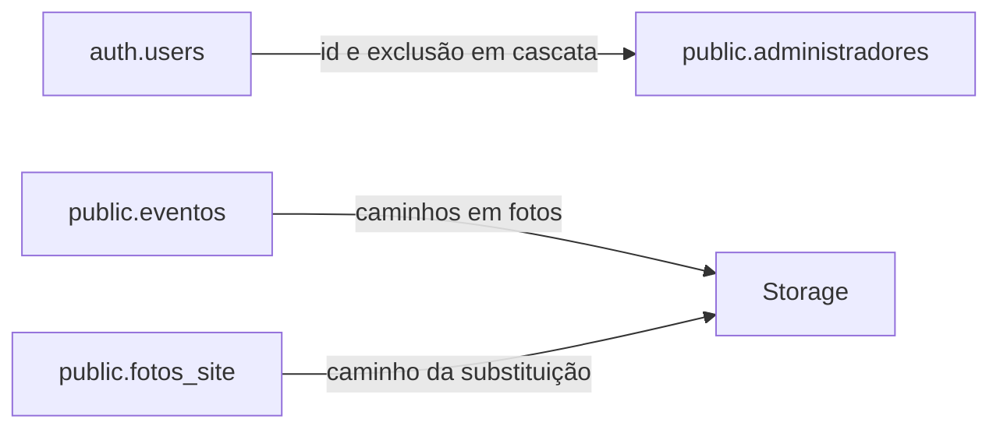

# Arquitetura, dados e implantação

O site pode ser distribuído como `dist/`, enquanto `/admin` depende do Express. O backend segue rotas → controladores → modelos, com clientes Supabase em `backend/configuracao/supabase.js`.

`backend/modelos/eventos.js` compara a coluna `versao` ao atualizar/excluir. O controlador trata conflitos. Banco e Storage não formam uma transação distribuída.

## Esquema versionado

- `202611100001_eventos_e_fotos.sql`: eventos, fotos institucionais e Storage.
- `202611100002_administradores.sql`: nomes normalizados e associação UUID ao Auth, com exclusão em cascata.

Não há FK de autoria entre eventos e administradores. Caminhos de Storage também não são FKs. Os modelos usam chave privilegiada no servidor; autorização nos controladores é obrigatória.

## Operação

`npm run build` remove/recria `dist/`, copia recursos e, com `URL_BACKEND_PUBLICO`, escreve a origem no módulo público. A variável contém URL pública, nunca segredo.

O backend serve `/api`, `/admin`, `/painel-assets` e `dist`. `RENDER=true` ou `NF_DEPLOYMENT_SHA` ajustam trust proxy para um salto; conferir a topologia da hospedagem. Arquivos de provedor não comprovam implantação ativa.

Preparar um ambiente requer revisar SQL e contas em instância isolada. Esta alteração documental não aplica SQL, não cria contas e não modifica produção.
